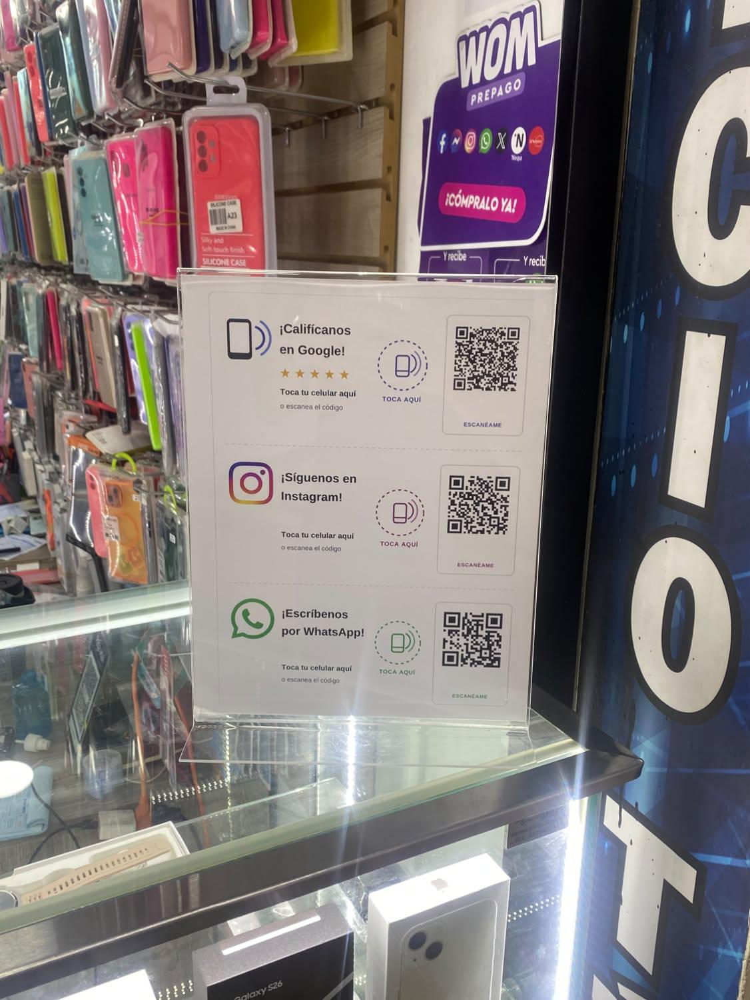
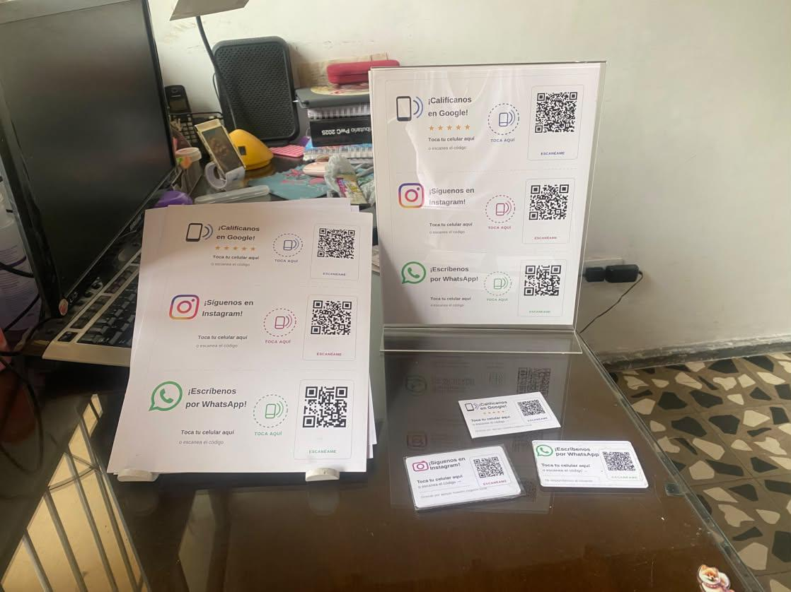
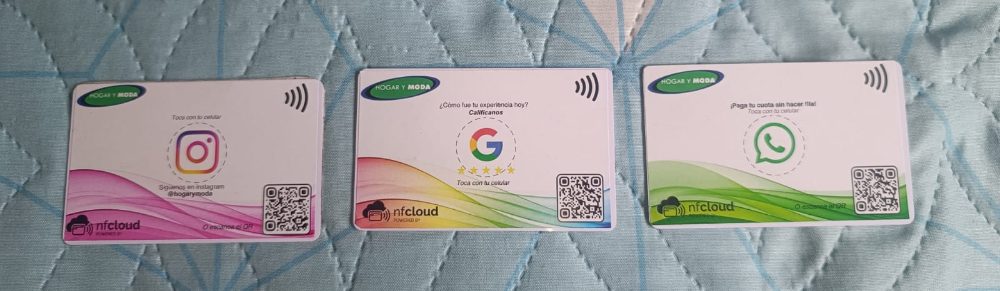

# NFCloud — Resumen del proyecto

**Para:** Santiago Gimenez Londoño
**De:** David Quintero Gallego 
**Fecha:** octubre de 2026
**Propósito:** base para estructurar el proyecto.

---

## 1. Qué es NFCloud (en una frase)

Una plataforma SaaS que convierte cualquier punto físico de un negocio en un canal
digital **medible y actualizable a distancia**, usando tarjetas NFC o códigos QR: el
cliente acerca el celular (o escanea) y es dirigido a reseñas, redes, WhatsApp,
catálogos o lo que el negocio decida — y cada interacción queda registrada por sede.

**La diferencia clave frente a un QR normal:** el destino de la tarjeta se cambia
desde un panel central en segundos, **sin reimprimir ni volver a programar nada**, y
todo lo que ocurre se mide. Un QR impreso es fijo y ciego; NFCloud es dinámico y
medible.

---

## 2. El problema que resuelve

Los negocios físicos (tiendas, restaurantes, comercios) tienen miles de interacciones
diarias con clientes contentos que **nunca se traducen en nada digital**:
- El cliente satisfecho no deja reseña (pero el molesto sí).
- No hay forma de medir qué tanto interactúa la gente en cada punto o sede.
- Cambiar una campaña (un catálogo, una promoción) implica reimprimir material en
  cada local.
- Las cadenas con muchas sedes no tienen control ni analítica centralizada de esto.

NFCloud ataca justo eso: capta la interacción física que ya ocurre y la convierte en
reputación, seguidores, contactos y datos, de forma centralizada y medible.

---

## 3. Cómo funciona (técnico, explicado simple)

El mecanismo central es una **indirección**: la tarjeta no guarda el destino final,
guarda un enlace a mi servidor con un identificador único.

```
Cliente acerca el celular a la tarjeta (o escanea el QR)
        │
        ▼
Se abre:  https://nfcloud.up.railway.app/r/{código}
        │
        ▼
Mi servidor recibe el código, consulta a dónde debe ir ese punto
        │
        ├──► Redirige al destino configurado (reseñas / WhatsApp / Instagram / catálogo…)
        │
        └──► Registra el escaneo (fecha, hora, sistema operativo, canal, sede)
```

Como el destino vive en el servidor (no en la tarjeta), puedo cambiarlo cuando quiera
desde un panel web. La misma tarjeta física, mañana, puede llevar a otro lugar.

**La plataforma incluye hoy**
- Motor de redirección en tiempo real (respuesta en milisegundos).
- Panel de control (dashboard) con analítica: total de escaneos, tendencia por día,
  sede más activa, horas pico, distribución por sistema operativo (iOS/Android) y por
  canal de destino (WhatsApp, Instagram, reseñas, etc.).
- Comparativa entre sedes (ranking de las que más y menos rinden).
- Módulo de salud operativa: detecta si una tarjeta dejó de usarse (soporte caído,
  retirado o dañado).
- Gestión multi-empresa: cada cliente ve solo sus datos, con su propio acceso.
- Cambio masivo de destinos: actualizar todas las sedes de una cadena con un clic,
  con historial y opción de revertir.
- Generador de códigos QR por punto.
- Login seguro, control de suscripción (activar/suspender clientes), copias de
  seguridad.

**Stack tecnológico:** Node.js + TypeScript (backend), PostgreSQL (base de datos),
Redis (caché para respuesta rápida), interfaz web propia. Desplegado en la nube
(Railway), funcionando 24/7 ,estoy pensando en adquirir el dominio , usa HTTPS.

---

## 4. Costos reales

### Costos por unidad (variables, lo que me cuesta producir)

| Insumo | Costo aproximado |
|--------|------------------|
| Tarjeta NFC(chip) | ~$1.900 COP c/u |
| Impresión de stickers en papel acrílico (salen ~10 por hoja) | ~$4.000–5.000 COP la hoja (~$400–500 por sticker) |
| Soporte "hablador" en acrílico tamaño carta | ~$29.000 COP (buscando proveedores más baratos) |
| Grabación/programación de una tarjeta | Prácticamente $0 en dinero; es mi tiempo (minutos por tarjeta para su escritura NFC) |

**Ejemplo de costo de un hablador completo** (acrílico + póster + 3 tarjetas):
29.000 + 4.000 + (3 × 1.900) = **~$38.700 COP de costo**.

### Costos recurrentes (infraestructura del software)

| Concepto | Costo aproximado |
|----------|------------------|
| Hosting en la nube (Railway: app + base de datos + caché) | ~$20.000 COP/mes (≈ 5 USD) |
| Dominio propio (cuando se compre) | ~$50.000–60.000 COP/año |

**Nota (lectura de negocio Segun la IA):** el costo de producción bajo **
, es la fortaleza del modelo.**
 (más reseñas, más leads, analítica, control centralizado). Un costo
variable bajo + una infraestructura que cuesta casi lo mismo con 1 cliente o con 50 =
**márgenes altos y un negocio escalable**, que es exactamente lo que caracteriza a un
SaaS sano. El software es un activo propio, sin licencias de terceros recurrentes, así
que el margen crece a medida que se suman clientes. En otras palabras: barato de
producir, valioso de usar.

**Queda totalmente a criterio del profe**

---

## 5. Modelo de ingresos

Dos fuentes:

1. **Venta de hardware (pago único):** tarjetas NFC, habladores, pósters. Es el
   "ticket de entrada" del cliente.
2. **Mensualidad de plataforma (recurrente):** por usar NFCloud — gestión de
   destinos, analítica, soporte. **Este seria un ingreso recurrente,si deciden optar por tarjetas dinamicas**, vendria siendo un 
   ingreso que se repite mes a mes con costo marginal bajísimo.

La estrategia recomendada por la IA: entrar con el hardware (venta fácil de entender) y convertir al cliente
en suscriptor recurrente de la plataforma, que es donde está el valor a largo plazo.

---

## 6. Estado actual del negocio (qué tengo hoy)

Tres clientes reales, en distintas etapas:

**Lalico (Licorería · Medellín)** — en funcionamiento desde el 5 de septiembre.
- 3 tarjetas instaladas (Google Reviews, WhatsApp, Instagram).
- Hoy solo se promociona activamente la de reseñas; las otras dos están puestas pero
  aún no "vendidas" como servicio (el cliente las tomaría sin dudar).
- **Resultado medible:** pasó de **5 a 29 reseñas en Google en ~2 semanas**,
  manteniendo 5 estrellas. Los clientes empezaron a subir fotos del local por su
  cuenta.

**Celumóvil (Centro comercial · Itaguí)** — desde el 21 de septiembre.
- **9 puntos NFC** distribuidos (acrílico, póster en ventana, tarjetas de mostrador).
- No tenía ni ficha en Google Maps; se creó desde cero.
- **Resultado:** primeras reseñas, nuevos seguidores, y contactos de WhatsApp
  rastreables (el mensaje viene identificado, se sabe que vino de la tarjeta).

**Río Vivo (Spa)** — compra confirmada, pendiente de entrega esta semana.
- 10 tarjetas PVC + 1 hablador en acrílico tamaño carta con póster y 3 chips
  integrados (Google, Instagram, WhatsApp).
- Primera venta formal cerrada por cotización. Aún no en funcionamiento (entrega esta
  semana).

**Resumen de tracción:** 3 negocios, ~22 puntos NFC entre instalados y por entregar,
un caso de éxito medible y contundente (Lalico 5→29), y una primera venta formal
cerrada.

---

## 6.1. Evidencia visual del producto

El producto es tangible y ya está instalado en negocios reales. A continuación, las
presentaciones en las que se ofrece:

**Foto 1 — Hablador en acrílico instalado en punto de venta (Celumóvil).**
Un soporte "hablador" tamaño carta sobre la vitrina de una tienda de accesorios de
celular. Muestra las tres acciones apiladas, cada una con su llamado claro, su zona de
"Toca aquí" (NFC) y su código QR: "¡Califícanos en Google!" (con 5 estrellas),
"¡Síguenos en Instagram!" y "¡Escríbenos por WhatsApp!". Es la presentación de
mostrador, instalada en un negocio real.



**Foto 2 — Formatos de presentación (hablador + póster + tarjetas de mostrador).**
Vista comparativa de los distintos soportes: el hablador en acrílico de pie, el póster
plano y las tarjetas individuales de mostrador. Deja ver que un mismo sistema se
adapta a varios formatos según dónde se ubique en la tienda (vitrina, mostrador, pared).



**Foto 3 — Tarjetas NFC rediseñadas con marca (muestra Hogar y Moda + NFCloud).**
Tres tarjetas tipo PVC con el nuevo diseño de marca: a la izquierda Instagram
("Síguenos en Instagram"), al centro Google ("¿Cómo fue tu experiencia hoy?
Califícanos") y a la derecha WhatsApp ("Paga tu cuota sin hacer fila"). Llevan el logo
de la empresa cliente (muestra con "Hogar y Moda") y el sello **"nfcloud · powered by"**.
Es la versión de producto terminado y con marca, hecha como muestra para presentar a
una cadena. (NFCloud como marca nació después de arrancar con las tarjetas NFC; esta
es la imagen más actual del producto.)



---

## 7. Oportunidad de crecimiento

- **Cliente grande en el horizonte:** una cadena regional de electrodomésticos/moda
  con ~84 sedes (acceso directo por contacto familiar). Su reputación digital
  promedia 3,8 estrellas con muy pocas reseñas por sede (4 a 30 veces menos que la
  competencia). Es exactamente el problema que NFCloud resuelve a escala.
- **Mercado amplio:** cualquier negocio con punto físico y clientes (comercios,
  restaurantes, spas, cadenas). El profesor mencionó esto y varias opciones de las cuales el tiene el conocimiento
  — todos encajan para el modelo de negocio.

---

## 8. Qué busco al estructurar el proyecto (espero a recomendacion del profe , la IA genero algunas recomendaciones)

- Ordenar el modelo de negocio y la propuesta de valor para presentarlo en On Going.
- Definir estrategia comercial y de precios (hardware + mensualidad).
- Validar el camino de escalamiento: de los primeros clientes a cuentas grandes.
- Aprovechar los contactos y la salida comercial

**El producto ya existe y funciona.** Mi reto principal hoy es comercial y de
estructuración/diseño ,quizas mejoras técnicas — y es justo donde la asesoría del profesor
suman muchísimo.

---

## 9. Dilemas abiertos y variables por definir

Estas son las decisiones en las que me gustaría contar tambien con tu criterio al estructurar
el proyecto. Las dejo explícitas porque son las que más vueltas me han dado.

### a) Precios: la variable más difícil

- No sé fijar bien el precio para un cliente pequeño (spa, tienda) vs. una cadena
  grande de 84 sedes. Son escalas completamente distintas.
- Dudo entre cobrar **por tarjeta**, **por sede** o **por paquete cerrado**. Cobrar
  por tarjeta suena a ferretería; por sede o por valor suena más a servicio.
- La **mensualidad** es lo más delicado: ¿cuánto es justo sin asustar al cliente pero
  sin regalar el valor recurrente? Con un cliente grande, la matemática da cifras muy
  altas (podrían ser varios millones/mes) y me preocupa que ese número espante en vez
  de cerrar.
- Pregunta de fondo: ¿conviene entrar barato para ganar el primer gran cliente y
  tener caso de éxito, o cobrar lo que vale desde el inicio?

### b) Estructura de las tarjetas (producto)

- **Tarjetas específicas** ("Reseñanos", "Síguenos", "Escríbenos") vs. **una sola
  tarjeta a un menú tipo Linktree**. Las específicas convierten mejor (la gente sabe
  qué hacer), pero implican más tarjetas por punto. El menú usa menos tarjetas pero
  no quiero que confunda al cliente.
- ¿Cómo manejar la "tarjeta que lleva a cualquier redireccion que elijas" (destino que cambia) sin que choque con la
  coherencia? Si una tarjeta dice "Reseñanos" no puedo cambiarla a una promoción sin
  engañar; para eso necesito tarjetas de mensaje neutro.

### c) Escala y operación

- El salto de **vender puerta a puerta** (reuniones una a una) a un modelo que escale
  de verdad. ¿Cómo se hace repetible?
- ¿Cómo manejar la **instalación física** en algun negocio que requiera multiples tarjetas (logística que hoy no tengo resuelta).

### d) Cobros y formalización

- Hoy el cobro sería **manual** (transferencia/Nequi). ¿Cuándo conviene pasar a una
  pasarela con cobro recurrente automático (Wompi, Mercado Pago)?
- ¿Conviene **constituir empresa** ya, o esperar? 

### e) Posicionamiento comercial

- ¿Me presento como "producto tecnológico" o como "resultado de negocio" (más
  reseñas, más leads)? 
- ¿Cómo diferenciarme claramente del "QR gratis" en la cabeza del cliente?

### f) Prioridades de tiempo

- ¿Cancelar la reunión del viernes en On Going y esperar a estructurar mejor el
  proyecto, o asistir ya?

---

## Datos 

- **Nombre:** David Quintero Gallego
- **Contacto:** +57 300 724 0273 · 
dquinterg1@eafit.edu.co
- **Formación:** Ingenieria en sistemas EAFIT

